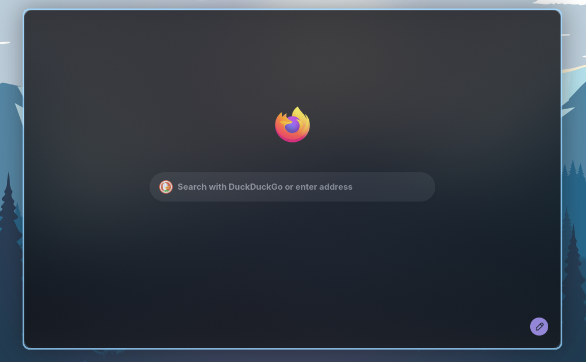

# fox
A  minimalistic, lightweight, and clean Firefox userChrome.css theme.
Every UI panel is hidden by default, leaving nothing but your content. Sidebar reveals  only when you use a keybind.



## Requirements
- Firefox 136+ (native vertical tabs)
- `toolkit.legacyUserProfileCustomizations.stylesheets = true` in `about:config`

## Installation
1. **Clone the repo** (or download the source):

   ```bash
   git clone https://github.com/fallenwesii/fox.git
   ```

2. **Create  chrome directory** inside your Firefox profile:

   ```bash
    ~/.config/mozilla/firefox/<profile>/
   ```

3. **Copy userChrome.css** to the chrome directory
4. **Restart Firefox** - the theme activates on next launch.

## Toggle Visibility
Press **Ctrl+Alt+Z** or click the **Toggle sidebar** button to switch between:

## ## License
**MIT**
